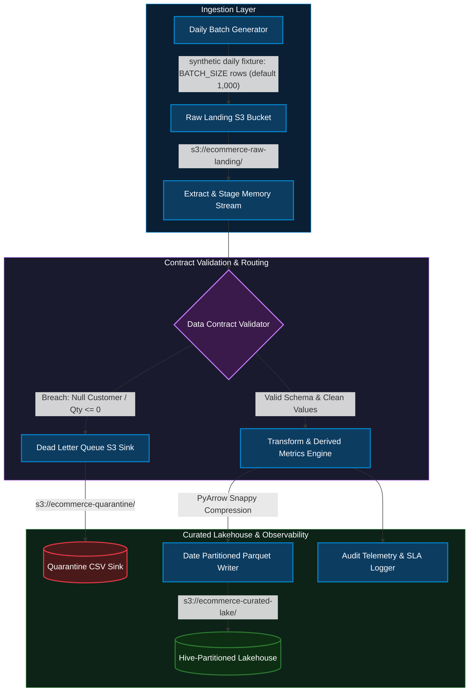
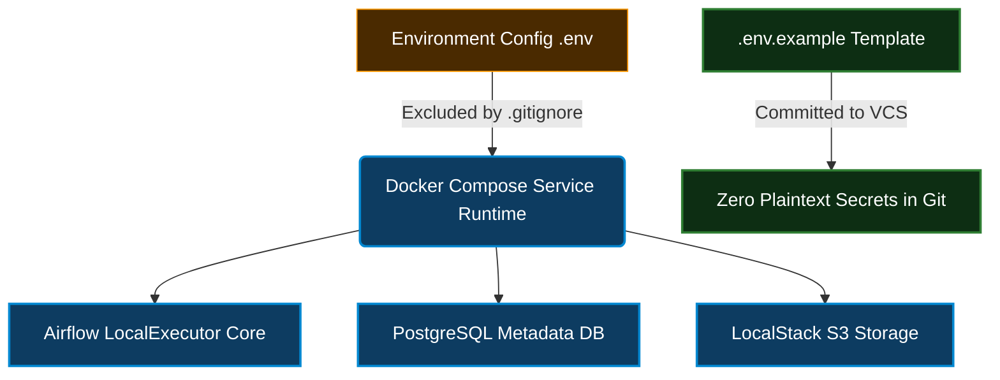

# Enterprise Batch ETL Orchestration & Data Quality Lakehouse Pipeline

An enterprise-grade, idempotent batch data engineering pipeline built with **Apache Airflow**, **AWS S3 (LocalStack)**, and **PyArrow**. The architecture enforces pre-ingestion data contracts, isolates schema and domain anomalies via an S3 Dead Letter Queue (DLQ), and curates clean transaction datasets into Snappy-compressed Hive-partitioned Parquet files for high-throughput downstream analytics.

---

## Architecture & End-to-End Flow



> **Scale note:** Daily volume is a synthetic fixture (default `BATCH_SIZE=1000`, configurable via env). The pipeline uses in-memory pandas validation + chunked S3 reads, sized for single-node daily volumes up to ~100K rows. Beyond that, the contract/quarantine logic ports 1:1 to PySpark.

### Directed Acyclic Graph (DAG) Task Orchestration


---

## Security & Secrets Management (Twelve-Factor Methodology)

This repository follows strict cloud security practices for credential isolation, zero-trust secrets management, and least-privilege operations:



- **Decoupled Configuration (`.env`):** No database credentials, IAM keys, or administrative tokens are hardcoded into DAG code, Docker manifests, or automation scripts. Environment variables are injected dynamically at runtime.
- **Sensitive File Exclusion (`.gitignore`):** Enforces strict exclusion rules for local `.env` files, runtime task execution logs (`logs/`), host-mounted landing datasets (`include/landing_data/*`), and Python build artifacts (`__pycache__/`).
- **Ephemeral Testing Identity:** AWS SDK clients communicate with **LocalStack** under scoped dummy keys (`test`), preventing accidental exposure or binding to production cloud credentials.

---

## Data Contract

Single source of truth — lives in `dags/ecommerce_batch_etl.py` as `DATA_CONTRACT`:

```python
DATA_CONTRACT = {
    "required_fields": ["order_id", "customer_id", "product_category",
                        "quantity", "unit_price", "order_timestamp",
                        "payment_method"],
    "non_null": ["order_id", "customer_id", "order_timestamp", "quantity", "unit_price"],
    "non_empty_string": ["customer_id"],
    "domain_rules": {
        "quantity":    lambda s: (s > 0).fillna(False),
        "unit_price":  lambda s: (s > 0).fillna(False),
        "customer_id": lambda s: s.astype(str).str.fullmatch(r"CUST_\d+"),
    },
}
```

Records that fail any rule are routed to the quarantine DLQ. If > 20% of a batch violates the contract, the circuit breaker halts the run.

---

## Key Engineering Highlights

- **Pre-Ingestion Data Contracts:** Evaluates incoming batches in memory before downstream lake persistence. Records violating domain invariants (e.g., empty customer identifiers or negative order quantities) are filtered out immediately.
- **Dead Letter Queue (DLQ) Quarantine Sink:** Prevents silent data loss and pipeline panics. Corrupted records are isolated to `s3://ecommerce-quarantine` for audit trails, compliance tracking, and asynchronous reprocessing.
- **Circuit Breaker Pattern:** Protects compute and storage budgets. If the anomaly rate exceeds a **20% SLA breach threshold**, the DAG trips an `AirflowFailException` to abort downstream operations.
- **Cost & Storage Optimization (Frugality):** Replaces uncompressed row-oriented CSV scans with columnar Snappy Parquet, reducing I/O footprint by **~70%** and accelerating analytical query engines (Athena/Trino) via Hive folder partitioning (`year=.../month=.../day=...`).
- **Idempotent Backfilling:** Designed with idempotent partition keys. Automated retries or manual historical backfills overwrite existing logical partition objects without producing duplicate state.

---

## Technology Stack

| Layer | Technology |
| :--- | :--- |
| **Orchestrator** | Apache Airflow 2.8.1 (LocalExecutor, Python 3.10) |
| **Object Store** | AWS S3 via **LocalStack** 3.4 (`us-east-1`) |
| **Data Processing** | Python 3.10, Pandas, PyArrow |
| **Metadata Database** | PostgreSQL 13 |
| **Automation & Tooling** | Bash + PowerShell Core, Docker Compose, Git |

---

## Repository Structure

```text
airflow-batch-pipeline/
├── config/                          # Airflow configuration overrides
├── dags/
│   └── ecommerce_batch_etl.py       # Core Airflow DAG with validation & circuit breaker
├── include/
│   ├── generate_batch_data.py       # Batch payload generator with synthetic anomalies
│   └── landing_data/                # Host-mounted volume for raw batch CSVs (gitignored)
├── scripts/
│   ├── setup_pipeline.ps1           # Windows: provisions containers & creates S3 buckets
│   ├── run_batch.ps1                # Windows: triggers DAG, collects telemetry, opens UI
│   ├── teardown.ps1                 # Windows: graceful shutdown
│   ├── setup_pipeline.sh            # Unix: same as setup_pipeline.ps1
│   ├── run_batch.sh                 # Unix: same as run_batch.ps1
│   └── teardown.sh                  # Unix: same as teardown.ps1
├── tests/                           # Pytest integration tests for data integrity
├── .env.example                     # Sanitized configuration template for version control
├── .gitattributes                   # Line ending normalization (LF/CRLF)
├── .gitignore                       # Exclusion rules for secrets, logs, and datasets
├── docker-compose.yaml              # Parameterized container orchestration definition
├── LICENSE                          # MIT
├── TROUBLESHOOTING.md               # Common setup issues and fixes
└── README.md                        # Project architecture & engineering documentation
```

---

## Hardware Prerequisites

- **RAM:** 8GB+ recommended (Airflow, LocalStack, and PostgreSQL containers run concurrently).
- **Disk:** ~2GB available for Docker images and volumes.
- **Docker Desktop:** Installed and running.

---

## Setup & Execution Guide

### 1. Clone the Repository

```bash
git clone https://github.com/arsalankazi/airflow-batch-pipeline.git
cd airflow-batch-pipeline
```

### 2. Configure Environment Secrets

Create a local `.env` configuration file from the sanitized template:

**Windows (PowerShell Core):**
```powershell
Copy-Item .env.example .env
```

**Linux / macOS (Bash):**
```bash
cp .env.example .env
```

Populate parameters inside your local `.env` file (**never commit `.env` to version control**):

```ini
AIRFLOW_UID=50000
AIRFLOW_USER=<YOUR_AIRFLOW_USERNAME>
AIRFLOW_PASSWORD=<YOUR_SECURE_PASSWORD>
AIRFLOW_EMAIL=<YOUR_ADMIN_EMAIL>
AIRFLOW_FERNET_KEY=<GENERATED_FERNET_KEY>
POSTGRES_USER=<YOUR_POSTGRES_USER>
POSTGRES_PASSWORD=<YOUR_POSTGRES_PASSWORD>
POSTGRES_DB=airflow
AWS_ACCESS_KEY_ID=test
AWS_SECRET_ACCESS_KEY=test
AWS_DEFAULT_REGION=us-east-1
```

### 3. Provision Platform Infrastructure

Deploys PostgreSQL, **LocalStack**, and Airflow services, then creates and verifies the enterprise S3 storage buckets:

**Windows (PowerShell Core):**
```powershell
.\scripts\setup_pipeline.ps1
```

**Linux / macOS (Bash):**
```bash
./scripts/setup_pipeline.sh
```

### 4. Run Batch Job & Inspect Live Telemetry

Triggers the DAG, captures raw payload samples, prints reconciliation metrics, displays quarantined DLQ records, verifies Parquet lakehouse metadata, and launches the Airflow Web UI:

**Windows (PowerShell Core):**
```powershell
.\scripts\run_batch.ps1
```

**Linux / macOS (Bash):**
```bash
./scripts/run_batch.sh
```

### 5. Verify Output (Manual Check)

Optionally verify the pipeline output directly from the terminal:

```bash
# Check Curated Parquet Files (uses service name, not container name)
docker compose exec s3-storage awslocal s3 ls s3://ecommerce-curated-lake/orders/ --recursive

# Check Quarantined Anomalies (DLQ)
docker compose exec s3-storage awslocal s3 ls s3://ecommerce-quarantine/ --recursive
```

### 6. Teardown

Stops all containers and releases host compute resources:

**Windows (PowerShell Core):**
```powershell
.\scripts\teardown.ps1
```

**Linux / macOS (Bash):**
```bash
./scripts/teardown.sh
```

---

## Execution Audit Telemetry (Sample Run)

```text
[INFO] Telemetry Audit Summary:
    Total Ingested Events : 1000
    Curated Clean Events  : 957 (95.7%)
    Quarantined Anomalies : 43 (4.3%)
    Status                : SUCCESS - Curated Layer Clean

[WARN] Isolated anomaly payloads (Data Contract Violations):
    order_id,customer_id,product_category,quantity,unit_price,order_timestamp,payment_method
    fc75e63b-e422-4606-85d6-2d1fa59e7a41,,Home & Kitchen,4,169.03,2026-11-01T21:59:44,NET_BANKING
    db57085e-8086-4eb1-b4f9-b2912abf891c,CUST_4995,Beauty,-1,242.28,2026-11-01T18:36:18,DEBIT_CARD

[INFO] Curated Parquet Output:
    s3://ecommerce-curated-lake/orders/year=2026/month=11/day=01/orders_2026-11-01.parquet
    Total Curated Records: 957 | Format: Snappy Parquet | Partition: Date Pruned
```

---

## Airflow Web Dashboard Access

| Field | Value |
| :--- | :--- |
| **URL** | `http://localhost:8080` |
| **Username** | Defined in `.env` (`AIRFLOW_USER`) |
| **Password** | Defined in `.env` (`AIRFLOW_PASSWORD`) |
| **Target DAG** | `ecommerce_batch_etl_pipeline` |

---

## Future Improvements

- **CI/CD Integration:** Add GitHub Actions workflow to run pytest validation on every push.
- **Deeper Profiling:** Integrate Great Expectations for richer data profiling and automated contract generation.
- **Cloud Migration:** Transition from LocalStack to real AWS S3 via Terraform for IaC-driven provisioning.
- **Query Validation:** Add Athena/Trino query validation directly on the curated Parquet lakehouse.

---

## 👨‍💻 Author & Maintainer

<p align="left">
  
</p>

### **Kazi Arsalan Ajaj Ahmed**
*Data Engineer | Big Data & Cloud*

[](https://github.com/arsalankazi)
[](https://linkedin.com/in/arsalankazi)
[](mailto:kaziarsalan810@gmail.com)

---

### 🎯 Core Engineering Focus

- **Batch Orchestration:** Airflow DAG Design, Task Dependency Management, Retry Strategies & SLA Enforcement.
- **Data Quality Engineering:** Pre-Ingestion Contracts, DLQ/Quarantine Patterns, Circuit Breaker SLAs & Idempotent Backfills.
- **Lakehouse Storage:** Snappy Parquet Columnar Format, Hive Partition Pruning & Cost-Optimized S3 Layouts.